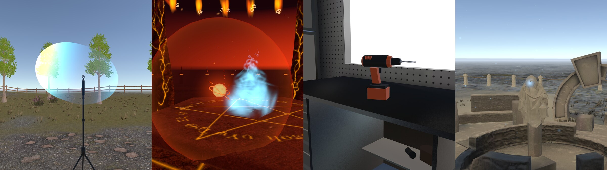
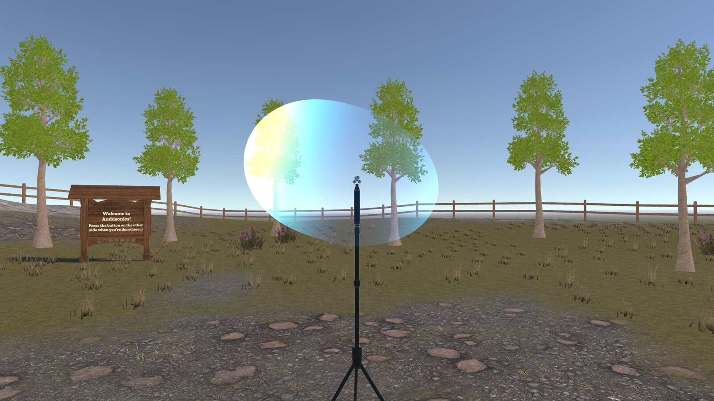
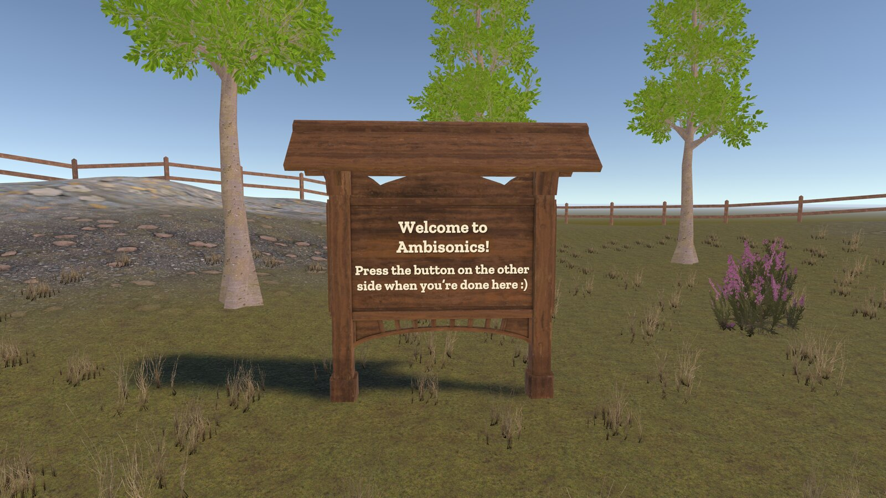
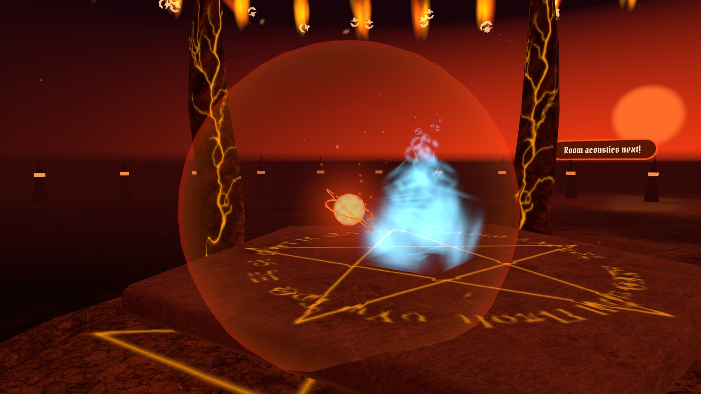
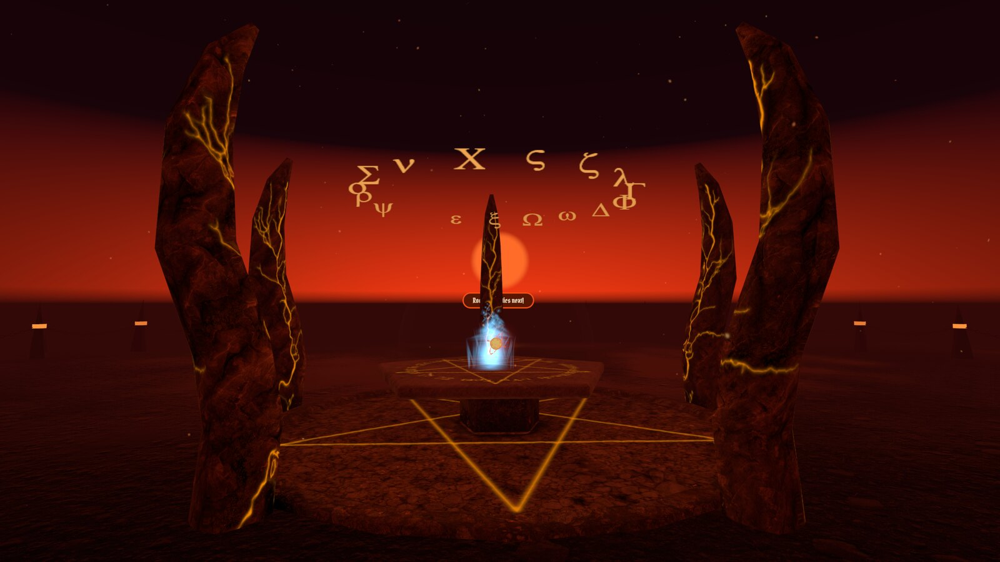
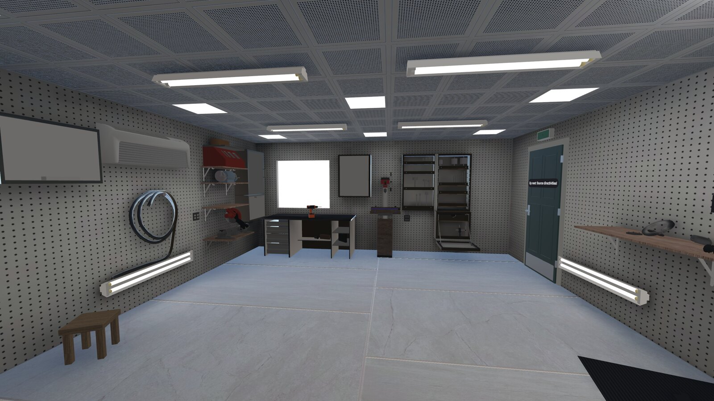
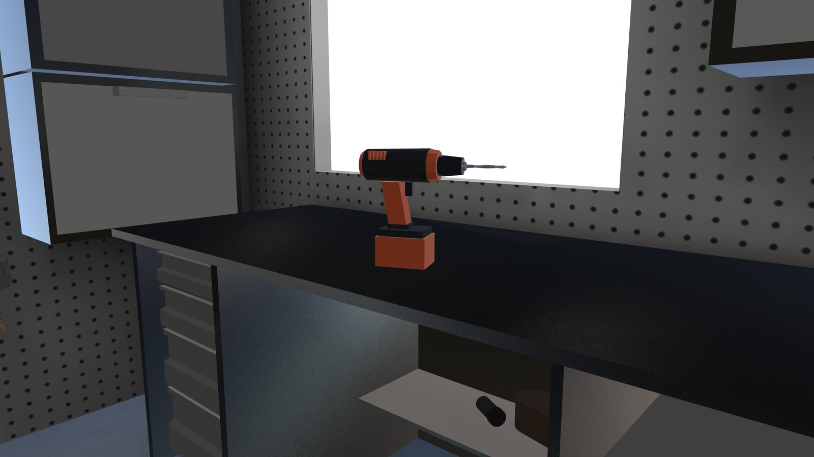
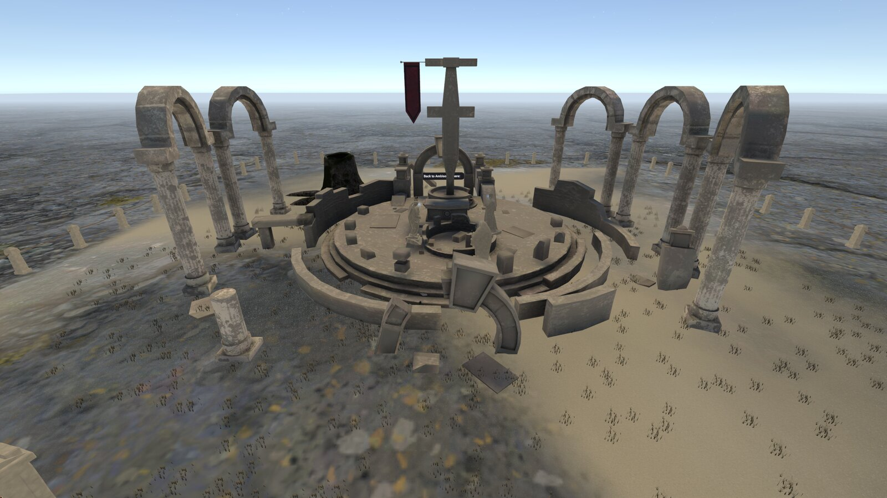
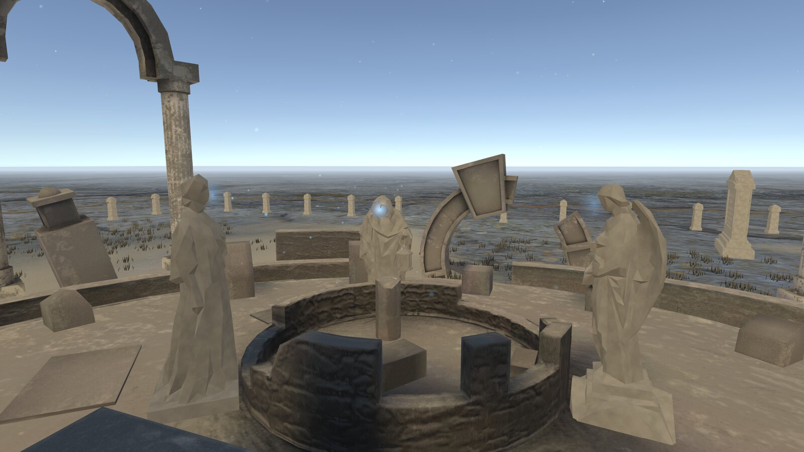

# Meta XR Audio SDK Demo

A small VR tour of spatial audio on Meta Quest, built with Unity 6 and the Meta XR Audio SDK.
Four scenes, each about one concept, each with a visualization that shows what you are hearing.



## The scenes

Every scene has a button (or a door) that takes you to the next one, and the last scene loops back to the first.

### 1. Ambisonics

A first-order ambisonic recording of a park plays all around you.
The globe on the microphone bulges and glows towards wherever the sound is coming from right now.

<p>
  
  
</p>

### 2. Point source

A whispering ember soul hovers above the altar and pulses with its own loudness.
Grab it, carry it around and hear the spatialization follow.

<p>
  
  
</p>

### 3. Room acoustics

Step into a garage where a power drill runs in bursts.
Reflections and reverb come from the Room Acoustic Properties object, and the drill is still grabbable.

<p>
  
  
</p>

### 4. Source directivity

Three statues talk to each other in a ruined temple.
Glowing motes stream from their mouths in the pattern of a human voice, so walking behind a speaker both looks and sounds different.

<p>
  
  
</p>

## Getting started

1. Clone the repository.
2. Open the project with Unity **6000.3.5f2** (with Android build support).
3. Build the APK and install it on a Quest as described below.
   The tour starts in `Assets/Scenes/Ambisonics.unity`.

Packages (Meta XR Audio SDK 83, Meta XR Core and Interaction SDK, URP 17) are restored automatically on first open.

## Building the APK in Unity

1. Open **File > Build Profiles** and select **Android**.
2. If Android is not the active platform yet, click **Switch Platform**.
   The first switch reimports all assets and can take a while.
3. Check that the scene list contains the four scenes with `Ambisonics` first.
   They are already set up in the project.
4. Click **Build** and save the APK into the `Builds` folder at the project root, for example as `Builds/MetaXRAudioDemo.apk`.
   The folder is ignored by git, so builds never end up in the repository.

The menu item **Tools > MetaAudioSDK Demo > Build Quest APK** does all of this in one click and writes `Builds/MetaXRAudioDemo.apk`.
With the editor closed you can also build from the terminal:

```sh
/Applications/Unity/Hub/Editor/6000.3.5f2/Unity.app/Contents/MacOS/Unity -batchmode -quit -projectPath . \
  -buildTarget Android -executeMethod MetaAudioSDKDemo.Editor.QuestBuild.BuildApk -logFile -
```

## Installing on the Quest with adb

### One-time setup

1. Install adb, for example with `brew install android-platform-tools` on macOS.
   Unity also ships a copy under `PlaybackEngines/AndroidPlayer/SDK/platform-tools` in its install folder.
2. In the Meta Horizon app on your phone, open your headset's settings and turn on **Developer Mode**.
   This needs a free developer account at [developers.meta.com](https://developers.meta.com).
3. Restart the headset and connect it to your computer with a USB cable that carries data.
4. Put the headset on and accept **Allow USB debugging**.
   Tick **Always allow from this computer** so you are not asked again.
5. Check the connection:

   ```sh
   adb devices
   ```

   The headset must be listed as `device`.
   `unauthorized` means step 4 is still missing, and an empty list means Developer Mode is off or the cable is charge-only.

### Installing the APK

```sh
cd Builds
adb install -r MetaXRAudioDemo.apk
```

`-r` replaces an existing installation and keeps its data, so run the same command after every new build.
On the headset, the app is in **Library** under the **Unknown Sources** filter, named **Meta XR Audio Demo**.

To see the app's log output while it runs:

```sh
adb logcat -s Unity
```

`scripts/install-quest.sh` combines these steps.
It checks the connection, installs `Builds/MetaXRAudioDemo.apk` (or the APK you pass as an argument) and starts the app.

To remove the app again:

```sh
adb uninstall com.metaxraudio.demo
```

## Where things are

| Folder | Contents |
| --- | --- |
| `Assets/Scenes` | The four scenes, in build order |
| `Assets/Scripts` | Visualizers, drill, door and scene loading |
| `Assets/Editor` | Helpers under **Tools > MetaAudioSDK Demo** |
| `Assets/Tests` | Play mode test that walks the whole scene loop |
| `Assets/ThirdParty` | Asset packs used for the environments |
| `SourceArt` | Blender sources of the custom models |
| `scripts` | `install-quest.sh` for installing a build with adb |
| `Builds` | APK output, not tracked by git |
